

  <!-- 01 HERO SECTION GIF -->
  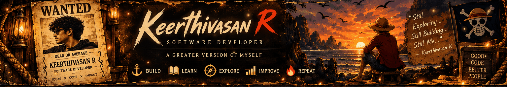

    

  <!-- Animated Pirate Typing Log -->
  

    

  <!-- Bounty & Status Badges -->
  

    
    
    
    
  

---

  

 

<!-- 2. ABOUT ME CARD -->

  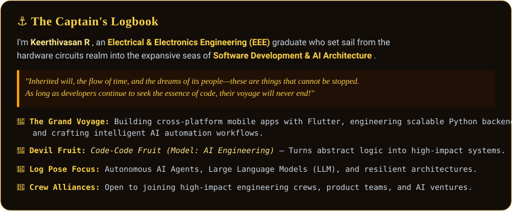

 

---

  

 

<!-- 3. JOURNEY VERTICAL FLOW -->

  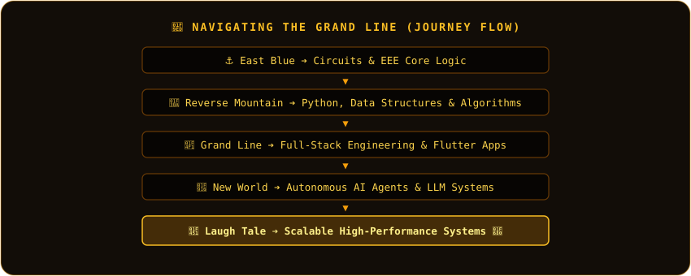

 

  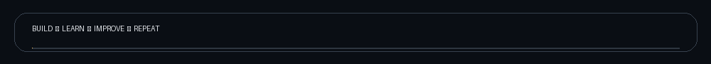

---

  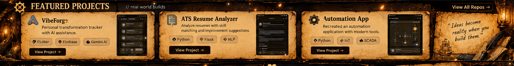

 

<!-- 4. ISLAND EXPEDITIONS (2x2 Grid) -->

  <a href="https://github.com/whiteknight-spec/vibeforge" target="_blank">
    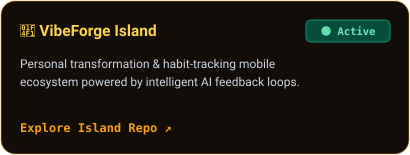
  </a>
  <a href="https://github.com/whiteknight-spec/ai-resume-gravity" target="_blank">
    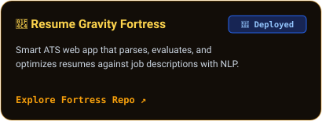
  </a>
   
  <a href="https://github.com/whiteknight-spec/ai-attendance-system" target="_blank">
    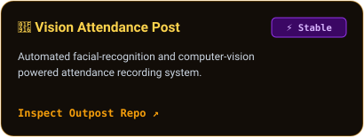
  </a>
  <a href="https://github.com/whiteknight-spec/english-ai-coach" target="_blank">
    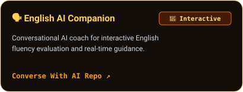
  </a>
   
  <a href="https://github.com/whiteknight-spec/flowbox-automation" target="_blank">
    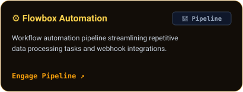
  </a>
  <a href="https://github.com/whiteknight-spec/python-questions" target="_blank">
    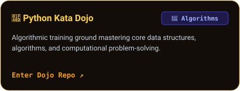
  </a>

 

---

  

 

<!-- 5. PIRATE WEAPONS & TECH ARSENAL -->

  
    
  

 

| Domain | Weapons & Technologies |
| :--- | :--- |
| **🗡️ Core Languages** | `Python` • `JavaScript` • `Dart` • `HTML5/CSS3` • `SQL` |
| **🛡️ Frontend & Mobile** | `Flutter` • `Dart` • `React (Basics)` • `Responsive UI` |
| **⚙️ Engine Room (Backend & APIs)** | `Flask` • `FastAPI` • `Node.js` • `RESTful APIs` |
| **💎 Databases & Cloud** | `Firebase` • `Supabase` • `MongoDB` • `PostgreSQL` • `SQLite` |
| **🧭 DevOps & Workflow** | `Git` • `GitHub` • `Docker` • `VS Code` • `Postman` |

---

<!-- 6. ANALYTICS & STATS -->

  
    

  
  &nbsp;
  

    

  

 

---

  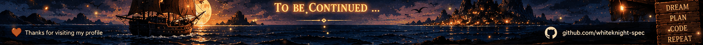

 

<!-- 7. TRANSPONDER SNAIL & CONTACT -->

  
    

  
Got a bold project, an open engineering role, or an alliance in mind? Send word to the flagship!

  
  &nbsp;
  
  &nbsp;
  
  &nbsp;
  

    

  

