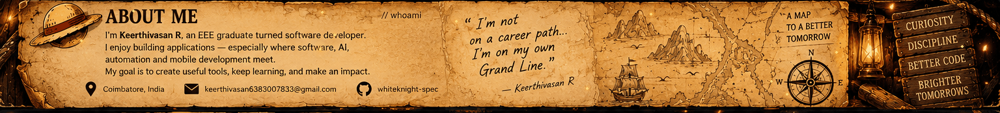
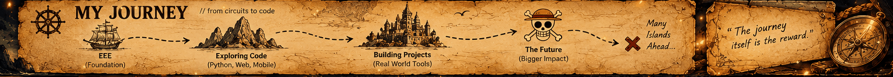
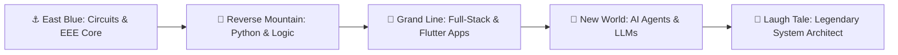
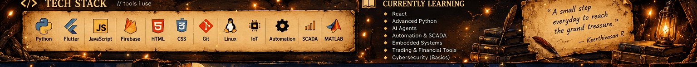

  <!-- 01 HERO SECTION GIF -->
  

    

  <!-- Animated Pirate Typing Log -->
  

    

  <!-- Bounty & Status Badges -->
  

    
    
    
    
  

---

  

 

### ⚓ The Captain's Logbook

I'm **Keerthivasan R**, an **Electrical & Electronics Engineering (EEE)** graduate who set sail from the hardware islands into the vast oceans of **Software Development & AI Architecture**.

> *"Inherited will, the flow of time, and the dreams of its people—these are things that cannot be stopped. As long as developers continue to seek the essence of code, their voyage will never end!"*

- 🌊 **The Grand Voyage:** Building cross-platform mobile apps with Flutter, crafting high-performance Python backends, and orchestrating intelligent AI workflows.
- 🍈 **Devil Fruit:** *Code-Code Fruit (Model: AI Engineering)* — Empowers the user to turn abstract logic into production-grade systems.
- 🧭 **Log Pose Direction:** Exploring Autonomous AI Agents, Large Language Models (LLM), and scalable cloud infrastructure.
- 🤝 **Crew Alliances:** Open to join innovative engineering crews, full-stack collaborations, and groundbreaking AI adventures.

---

  

 

### 🧭 Navigating the Grand Line

  

---

  

 

### 🏝️ Island Expeditions (Flagship Repositories)

| Island / Mission | Expedition Details & Architecture | Tech Arsenal | Logbook Link |
| :--- | :--- | :--- | :---: |
| **📱 VibeForge Island** | Personal transformation & habit-tracking mobile ecosystem powered by intelligent AI feedback loops. | `Flutter` `Firebase` `Gemini AI` | [Explore Island ↗](https://github.com/whiteknight-spec/vibeforge) |
| **📄 Resume Gravity Fortress** | Smart ATS web application that parses, evaluates, and optimizes resumes against job descriptions with NLP. | `Python` `Flask` `NLP` `JavaScript` | [Infiltrate Fortress ↗](https://github.com/whiteknight-spec/ai-resume-gravity) |
| **🤖 Vision Attendance Post** | Automated facial-recognition and computer-vision powered attendance recording system. | `Python` `OpenCV` `Machine Learning` | [Inspect Outpost ↗](https://github.com/whiteknight-spec/ai-attendance-system) |
| **🗣️ English AI Companion** | Conversational AI coach for interactive English fluency training and real-time guidance. | `Python` `AI / LLM` `Flask` | [Converse ↗](https://github.com/whiteknight-spec/english-ai-coach) |
| **⚙️ Flowbox Automation** | Workflow automation pipeline streamlining repetitive data processing and webhook events. | `Python` `APIs` `Automation` | [Engage Pipeline ↗](https://github.com/whiteknight-spec/flowbox-automation) |
| **🐍 Python Kata Dojo** | Algorithmic training ground conquering data structures and computational puzzles. | `Python` `Algorithms` `DSA` | [Enter Dojo ↗](https://github.com/whiteknight-spec/python-questions) |

---

  

 

| Skill Domain | Pirate Weapons & Tools |
| :--- | :--- |
| **🗡️ Core Blades (Languages)** | `Python` `JavaScript` `Dart` `HTML5` `CSS3` `SQL` |
| **🛡️ Armor & Ships (Frontend & Mobile)** | `Flutter` `React (Basics)` `Responsive UI` |
| **⚙️ Engine Room (Backend & APIs)** | `Flask` `FastAPI` `Node.js` `RESTful APIs` |
| **💎 Cargo & Treasure (Databases & Cloud)** | `Firebase` `Supabase` `MongoDB` `PostgreSQL` `SQLite` |
| **🧭 Navigational Gear (DevOps & Tools)** | `Git` `GitHub` `Docker` `VS Code` `Postman` |

 

  

---

### 📊 Logbook Telemetry & Bounty Analytics

  
  &nbsp;
  

    

  

---

  

 

### 🐌 Send a Transponder Snail (Den Den Mushi)

  
Got a bold project, an open engineering role, or an alliance in mind? Send word to the flagship!

  
  &nbsp;
  
  &nbsp;
  
  &nbsp;
  

    

  "People's dreams... have no end!" — Marshall D. Teach • Crafted with ⚓ by Keerthivasan R.

