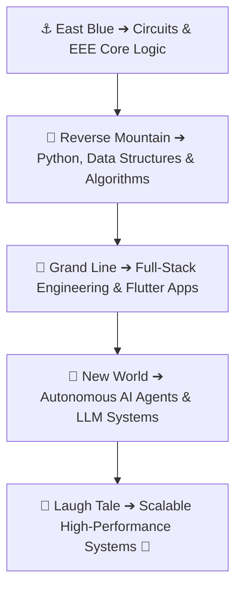

  <!-- 01 HERO SECTION GIF -->
  

    

  <!-- Animated Pirate Typing Log -->
  

    

  <!-- Bounty & Status Badges -->
  

    
    
    
    
  

---

  

 

### ⚓ The Captain's Logbook

I'm **Keerthivasan R**, an **Electrical & Electronics Engineering (EEE)** graduate who set sail from the hardware circuits realm into the expansive seas of **Software Development & AI Architecture**.

> *"Inherited will, the flow of time, and the dreams of its people—these are things that cannot be stopped. As long as developers continue to seek the essence of code, their voyage will never end!"*

- 🌊 **The Grand Voyage:** Building cross-platform mobile apps with Flutter, engineering scalable Python backends, and crafting intelligent AI automation workflows.
- 🍈 **Devil Fruit:** *Code-Code Fruit (Model: AI Engineering)* — Turns abstract logic and hardware concepts into high-impact software systems.
- 🧭 **Log Pose Focus:** Autonomous AI Agents, Large Language Models (LLM), and resilient full-stack architectures.
- 🤝 **Crew Alliances:** Open to joining forward-thinking software engineering crews, product teams, and high-impact AI ventures.

---

  

 

### 🧭 Navigating the Grand Line

  

---

  

 

### 🏝️ Island Expeditions (Flagship Repositories)

| Island / Mission | Status | Architecture & Tech Stack | Logbook Link |
| :--- | :---: | :--- | :---: |
| **📱 VibeForge Island** | `🟢 Active` | Personal transformation & habit-tracking mobile ecosystem powered by intelligent AI feedback loops. `Flutter` • `Firebase` • `Gemini AI` | [Explore Island ↗](https://github.com/whiteknight-spec/vibeforge) |
| **📄 Resume Gravity Fortress** | `🚀 Deployed` | Smart ATS web application that parses, evaluates, and optimizes resumes against job descriptions with NLP. `Python` • `Flask` • `NLP` • `JavaScript` | [Infiltrate Fortress ↗](https://github.com/whiteknight-spec/ai-resume-gravity) |
| **🤖 Vision Attendance Post** | `⚡ Stable` | Automated facial-recognition and computer-vision powered attendance recording system. `Python` • `OpenCV` • `Machine Learning` | [Inspect Outpost ↗](https://github.com/whiteknight-spec/ai-attendance-system) |
| **🗣️ English AI Companion** | `🧠 Interactive` | Conversational AI mentor for interactive English fluency evaluation and real-time guidance. `Python` • `AI / LLM` • `Flask` | [Converse ↗](https://github.com/whiteknight-spec/english-ai-coach) |
| **⚙️ Flowbox Automation** | `🔄 Pipeline` | Workflow automation pipeline streamlining repetitive data processing and webhook events. `Python` • `APIs` • `Automation` | [Engage Pipeline ↗](https://github.com/whiteknight-spec/flowbox-automation) |
| **🐍 Python Kata Dojo** | `🥋 Algorithms` | Algorithmic training ground mastering data structures, algorithms, and computational problem-solving. `Python` • `Algorithms` • `DSA` | [Enter Dojo ↗](https://github.com/whiteknight-spec/python-questions) |

---

  

 

### ⚔️ Pirate Weapons & Tech Arsenal

  

| Domain | Weapons & Technologies |
| :--- | :--- |
| **🗡️ Core Languages** | `Python` • `JavaScript` • `Dart` • `HTML5/CSS3` • `SQL` |
| **🛡️ Frontend & Mobile** | `Flutter` • `Dart` • `React (Basics)` • `Responsive UI` |
| **⚙️ Engine Room (Backend & APIs)** | `Flask` • `FastAPI` • `Node.js` • `RESTful APIs` |
| **💎 Databases & Cloud** | `Firebase` • `Supabase` • `MongoDB` • `PostgreSQL` • `SQLite` |
| **🧭 DevOps & Workflow** | `Git` • `GitHub` • `Docker` • `VS Code` • `Postman` |

---

### 📊 Logbook Telemetry & Bounty Analytics

  
  &nbsp;
  

    

  

---

  

 

### 🐌 Send a Transponder Snail (Den Den Mushi)

  
Got a bold project, an open engineering role, or an alliance in mind? Send word to the flagship!

  
  &nbsp;
  
  &nbsp;
  
  &nbsp;
  

    

  "People's dreams... have no end!" — Marshall D. Teach • Crafted with ⚓ by Keerthivasan R.

